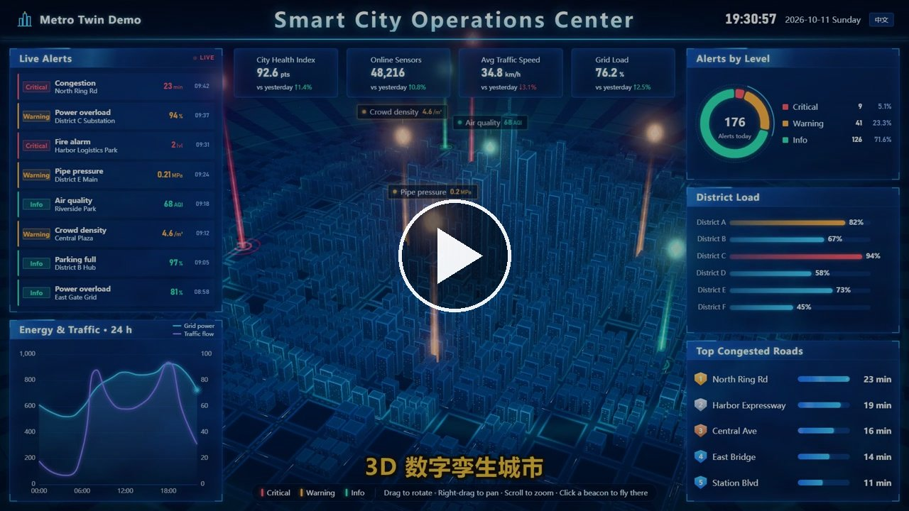
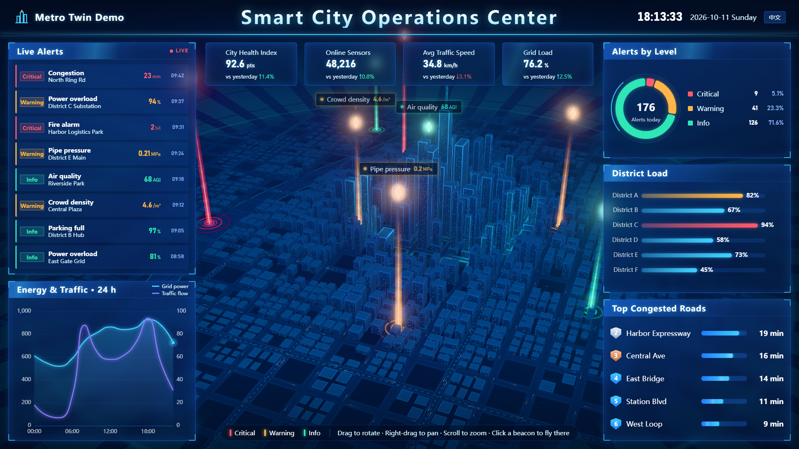
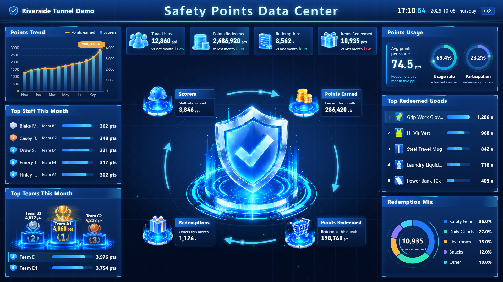
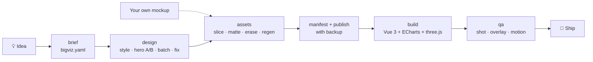

<div align="center">

# BigViz

### From one sentence to a production-grade data wall.

**AI-crafted big-screen dashboards: studio-quality mockups, clean 3D assets, a real-time
digital-twin city, and a real Vue 3 + ECharts codebase you actually ship.**

[](LICENSE)
[](https://github.com/Amtb8788/BigViz/actions/workflows/ci.yml)
[](plugins/bigviz/skills)
[](templates/vue3-echarts)
[](docs/guide-3d.md)
[](cli)
[](CONTRIBUTING.md)

**English** · [简体中文](README.zh-CN.md)

[Live demo](https://amtb8788.github.io/BigViz/) ·
[3D city demo](https://amtb8788.github.io/BigViz/#/city) ·
[Demo video](https://amtb8788.github.io/BigViz/promo/) ·
[Usage guide](docs/USAGE.md) ·
[Docs](docs/README.md)

</div>

[](https://amtb8788.github.io/BigViz/promo/)

<p align="center"><sub>BigViz in 38 seconds. Click to play.</sub></p>



<p align="center"><sub>Smart City Operations Center: a real-time 3D digital twin (<code>#/city</code>). Drag to orbit, scroll to zoom, click a beacon to fly there.</sub></p>



<p align="center"><sub>Safety command center (<code>deep-tech-blue</code> preset). Every number, label and chart is live code, not pixels. All data is fictional.</sub></p>

## Why BigViz

Big-screen dashboards usually take a designer, an illustrator and a front-end engineer a week
or more. The usual shortcuts fall short: a generated image can't take live data, and a
template looks like every other template.

BigViz turns your AI coding agent into the whole studio:

| | Typical AI image | Typical dashboard template | **BigViz** |
|---|:---:|:---:|:---:|
| Bespoke visual design | ✅ | ❌ | ✅ |
| Real, editable code | ❌ | ✅ | ✅ |
| Live data and exact text | ❌ | ✅ | ✅ |
| Clean transparent 3D assets | ❌ | ❌ | ✅ |
| Real-time 3D digital twin | ❌ | rarely | ✅ |
| Pixel-checked against the mockup | ❌ | ❌ | ✅ |

## Highlights

- **🎨 Design like a studio.** Style shoot-outs, hero A/B tests, batch renders and targeted fix
  passes. Quick mode ships a screen in 2–3 replies; studio mode lets you decide every step.
- **🧱 Ship code, not a screenshot.** Panels, text and charts are Vue components. Only 3D
  objects become images, so text is always exact and data is always live.
- **🏙️ Real-time 3D digital twin.** A procedural night city with alert beacons, camera tours,
  fly-to, orbit / pan / zoom. No models or textures, so it is licence-clean and works offline.
- **✂️ Assets that survive production.** Row-wise matting, text erase, HD regeneration, a
  measured manifest and publish with automatic backup.
- **🔍 Verified visually.** Playwright screenshots, overlays against the mockup and motion
  contact sheets, run by the agent.
- **🖥️ Built for real walls.** 1920×1080 design stage that adapts from 4:3 to 32:9, crisp text
  via CSS `zoom`, DPR-aware charts, reduced-motion support and a WebGL fallback.
- **🤝 Agent-agnostic.** Plain [Agent Skills](https://agentskills.io): Claude Code, Cursor, Codex
  and more. The CLI and template also work on their own.

## Quick start

### 1. Try the demo locally (1 minute, no key needed)

```bash
git clone https://github.com/Amtb8788/BigViz.git
cd BigViz/templates/vue3-echarts
npm install
npm run dev
```

Open <http://localhost:5173/> for the 2D command center and <http://localhost:5173/#/city>
for the 3D city. Requires Node 20.19+.

### 2. Build your own screen with an AI agent

**Claude Code**

```
/plugin marketplace add Amtb8788/BigViz
/plugin install bigviz@bigviz
```

Then describe what you want:

```
/bigviz A safety points command center for a tunnel project, deep blue tech style
```

Quick mode is the default: the agent writes the brief, renders mockups, picks the best one and
builds the page. You reply 2–3 times. Say "studio mode" for style shoot-outs, hero A/B and
panel refine. Want 3D? Add "with a 3D digital-twin city in the centre".

**Cursor, Codex and other Agent Skills tools**

```bash
git clone https://github.com/Amtb8788/BigViz
cp -r BigViz/plugins/bigviz/skills/* .agents/skills/     # or .cursor/skills/, ~/.codex/skills/
```

Paths differ per tool; check its docs for the skills folder.

### 3. Connect an image provider (optional)

```bash
export BIGVIZ_API_KEY=...                          # any OpenAI-compatible Images API; never commit it
export BIGVIZ_BASE_URL=https://api.openai.com/v1
export BIGVIZ_MODEL=gpt-image-1
```

No key? The agent builds the page with the template's bundled assets, or from a mockup you
already have.

👉 **Step-by-step manual with every command, option and troubleshooting tip:
[docs/USAGE.md](docs/USAGE.md)**

## How it works



One brain, two toolboxes:

| Role | Done by | Output |
|---|---|---|
| Product / brief | [`bigviz-brief`](plugins/bigviz/skills/bigviz-brief/SKILL.md) skill | `bigviz.yaml` spec |
| UI design | [`bigviz-design`](plugins/bigviz/skills/bigviz-design/SKILL.md) skill + CLI | mockups and contact sheets |
| Assets | [`bigviz-assets`](plugins/bigviz/skills/bigviz-assets/SKILL.md) skill + CLI | transparent HD assets + manifest |
| Front-end | [`bigviz-build`](plugins/bigviz/skills/bigviz-build/SKILL.md) skill + Vue 3 template | the running page |
| QA | [`bigviz-qa`](plugins/bigviz/skills/bigviz-qa/SKILL.md) skill + CLI | screenshots, overlays, checklist |
| Orchestration | [`bigviz`](plugins/bigviz/skills/bigviz/SKILL.md) skill | phases, gates and your decisions |

```
BigViz/
├── plugins/bigviz/            # the brain: Agent Skills + slash commands
├── cli/                       # design toolbox: Python CLI (mockups, matting, HD regen, screenshots)
├── templates/vue3-echarts/    # front-end toolbox: Vue 3 + ECharts + three.js screen kit
├── examples/safety-points/    # a complete example spec
├── docs/                      # usage guide, spec reference, architecture
└── .claude-plugin/            # Claude Code marketplace entry
```

## Presets

| Preset | Look | Good for |
|---|---|---|
| `deep-tech-blue` (default) | Deep navy, cyan glow, glass panels, 3D isometric icons | Command centres, smart city, construction |
| `editorial-dark` | Restrained dark UI, thin rules, strong typography | Executive and finance dashboards |
| `aurora-glass` | Glassmorphism with colourful accents | Product launches, marketing walls |

Presets are plain YAML in `cli/src/bigviz/presets/`. Override colours per screen with
`style.palette` in `bigviz.yaml`.

## The template

[`templates/vue3-echarts`](templates/vue3-echarts) is a standalone Vite + Vue 3 + TypeScript
screen with no UI library. Drop its kits into any existing app:

- **`src/screen/`**: `BigScreen`, `ScreenPanel`, `ScreenChart`, `RankList`, `CountUp`,
  `KpiCards`, `HeroHub`, `Podium`, `motion.ts`, `theme.css`
- **`src/screen3d/`**: `ThreeStage` and `CityHero`, lazy-loaded so 2D screens never download
  three.js

Data comes from `fetch` with runtime validation, silent refresh and last-good fallback. Point
`VITE_API_URL` (2D) or `VITE_CITY_API_URL` (3D city) at your backend and you are live.

## Use the CLI directly

The skills drive the `bigviz` CLI, and you can drive it yourself:

```bash
uv tool install "git+https://github.com/Amtb8788/BigViz#subdirectory=cli"

bigviz init my-screen --preset deep-tech-blue --locale en
cd bigviz/my-screen
bigviz probe                                   # record the real image sizes your provider returns
bigviz prompt design
bigviz gen prompts/<file>.txt --tag v1 --n 4
bigviz sheet "designs/*-v1-*.png" -o shots/v1-sheet.png
bigviz slice && bigviz matte --ids center-hub
bigviz regen --jobs 3 && bigviz manifest
bigviz publish --app ../../my-app --name MyScreen
bigviz shot http://localhost:5173/ --dpr 2 -o shots/full.png
bigviz overlay shots/full.png designs/<final>.png --alpha 0.5
```

All 15 commands are documented in [docs/USAGE.md](docs/USAGE.md#5-cli-reference).

## Documentation

| Doc | For |
|---|---|
| [Usage guide](docs/USAGE.md) | **Start here.** Install, first screen, CLI, template, 3D, deploy, troubleshooting |
| [使用手册（中文）](docs/USAGE.zh-CN.md) | The same guide in Chinese |
| [Spec reference](docs/guide-spec.md) | Every field in `bigviz.yaml` |
| [3D hero guide](docs/guide-3d.md) | The `screen3d` kit and the digital-twin city |
| [Matting guide](docs/guide-matting.md) | Choosing and tuning background removal |
| [Architecture](docs/ARCHITECTURE.md) | Repo layout and the contracts between CLI, template and skills |

## FAQ

**Which image model?** Any OpenAI-compatible Images API with generate and edit endpoints.
The default is `gpt-image-1`. Set `BIGVIZ_MODEL` and `BIGVIZ_BASE_URL` for others or a proxy.

**What does a screen cost?** It depends on your provider. A typical studio run is 6–9 style
images, 2–3 hero A/B, 4–7 final renders, 1–3 fixes and one regen per asset. Quick mode skips
the shoot-out and A/B. `--n` and `--quality` control spend.

**The model garbles my text, especially CJK.** It does not matter on the page: every string is
rendered by code from the spec. For the mockup, list risky strings under `pitfalls`, batch 4–7
renders, pick the most accurate and run one fix pass.

**No API key, or I already have a design?** Put your mockup in `designs/`, set `design.final`,
set `regen: false` on assets, then use `slice`, `matte`, `manifest` and `publish`. None of them
call the API.

**Does it run on a 4K wall or an old kiosk PC?** The stage adapts from 4:3 to 32:9, the 3D
pixel ratio is capped at 2, rendering pauses when the tab is hidden, and WebGL failure falls
back to a static image.

## Roadmap

- [x] Six Agent Skills, Python CLI, Vue 3 template, three presets
- [x] Quick mode: a first screen in 2–3 replies
- [x] Real-time 3D digital-twin city with interactive camera
- [ ] More 3D scenes (campus, factory, globe) and `--wait-for` in `bigviz shot`
- [ ] React template
- [ ] More presets and showcases
- [ ] Optional local super-resolution for assets

## Contributing

Issues and pull requests are welcome. Read [CONTRIBUTING.md](CONTRIBUTING.md) first:
everything in the repo must be original work, and example data must be fictional.
Security issues: see [SECURITY.md](SECURITY.md).

## Star history

If BigViz saves you a week of dashboard work, a ⭐ helps other people find it.

[](https://star-history.com/#Amtb8788/BigViz&Date)

## License

[MIT](LICENSE) © Amtb8788
