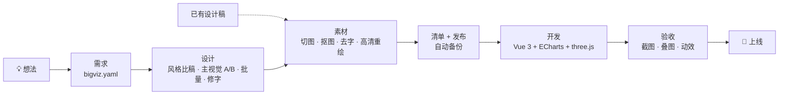

<div align="center">

# BigViz

### 一句话，生成一块能上线的数据大屏。

**AI 驱动的大屏全流程：工作室级设计稿、干净的透明 3D 素材、实时 3D 数字孪生城市，
以及一套真正可交付的 Vue 3 + ECharts 工程代码。**

[](LICENSE)
[](https://github.com/Amtb8788/BigViz/actions/workflows/ci.yml)
[](plugins/bigviz/skills)
[](templates/vue3-echarts)
[](docs/guide-3d.md)
[](cli)
[](CONTRIBUTING.md)

[English](README.md) · **简体中文**

[在线演示](https://amtb8788.github.io/BigViz/) ·
[3D 城市演示](https://amtb8788.github.io/BigViz/#/city) ·
[演示视频](https://amtb8788.github.io/BigViz/promo/) ·
[使用手册](docs/USAGE.zh-CN.md) ·
[文档](docs/README.md)

</div>

https://github.com/user-attachments/assets/06304dd5-e521-4724-bcea-e3051eae04b8

<p align="center"><sub>38 秒看懂 BigViz。</sub></p>


<p align="center"><sub>智慧城市运营中心：实时 3D 数字孪生（<code>#/city</code>）。拖拽旋转、滚轮缩放、点击告警点飞过去。</sub></p>


<p align="center"><sub>安全指挥中心（<code>deep-tech-blue</code> 预设）。所有数字、文字和图表都是代码渲染的，不是图片。数据均为虚构。</sub></p>

## 为什么是 BigViz

做一块大屏，通常要设计师、插画师、前端各忙一周以上。常见的捷径都不够用：AI 生成的图接不了真实数据，
现成模板又千篇一律。

BigViz 把你的 AI 编程助手变成一整个工作室：

| | 普通 AI 出图 | 普通大屏模板 | **BigViz** |
|---|:---:|:---:|:---:|
| 定制化视觉设计 | ✅ | ❌ | ✅ |
| 真实可改的代码 | ❌ | ✅ | ✅ |
| 实时数据、文字绝对准确 | ❌ | ✅ | ✅ |
| 干净的透明 3D 素材 | ❌ | ❌ | ✅ |
| 实时 3D 数字孪生 | ❌ | 少见 | ✅ |
| 截图与设计稿逐像素对比验收 | ❌ | ❌ | ✅ |

## 核心亮点

- **🎨 像设计工作室一样出稿。** 风格比稿、主视觉 A/B、批量出图、定点修字。快速模式 2–3 句话出成品，
  精修模式每一步都由你拍板。
- **🧱 交付代码，不是截图。** 面板、文字、图表全是 Vue 组件，只有 3D 物件才是图片，所以文字永远准确、
  数据永远是活的。
- **🏙️ 实时 3D 数字孪生。** 程序化生成的夜景城市，带告警光柱、自动巡航、点击飞行、旋转 / 平移 / 缩放。
  不依赖任何模型和贴图，版权干净，离线可用。
- **✂️ 素材能直接上生产。** 逐行抠图、去除烘焙文字、AI 高清重绘、自动测量尺寸清单、发布前自动备份。
- **🔍 视觉验收。** Playwright 截图、与设计稿叠图对比、动效连拍，全部由 AI 自动执行。
- **🖥️ 为真实大屏而生。** 1920×1080 设计稿，自适应 4:3 到 32:9；CSS `zoom` 保证文字清晰，
  图表按像素比渲染；支持减弱动效，WebGL 不可用时自动降级为静态图。
- **🤝 不绑定任何 AI 工具。** 标准 [Agent Skills](https://agentskills.io) 格式，Claude Code、Cursor、
  Codex 等都能用；CLI 和模板也可以单独使用。

## 快速开始

### 1. 本地跑起演示（1 分钟，不需要 Key）

```bash
git clone https://github.com/Amtb8788/BigViz.git
cd BigViz/templates/vue3-echarts
npm install
npm run dev
```

打开 <http://localhost:5173/> 看 2D 指挥中心，打开 <http://localhost:5173/#/city> 看 3D 城市。
需要 Node 20.19+。

### 2. 让 AI 帮你做一块自己的大屏

**Claude Code**

```
/plugin marketplace add Amtb8788/BigViz
/plugin install bigviz@bigviz
```

然后一句话说需求：

```
/bigviz 给隧道项目做一个安全积分指挥中心大屏，深蓝科技风，中文
```

默认是快速模式：AI 自己写需求、出设计稿、挑最好的一张、写好页面，你只需要回复 2–3 次。
想逐步比稿精修就说"用精修模式"；想要 3D，就加一句"中间做成 3D 数字孪生城市"。
完全新手请看 [三句话做出一块大屏](docs/guide-getting-started.zh-CN.md)。

**Cursor、Codex 等支持 Agent Skills 的工具**

```bash
git clone https://github.com/Amtb8788/BigViz
cp -r BigViz/plugins/bigviz/skills/* .agents/skills/     # 或 .cursor/skills/、~/.codex/skills/
```

不同工具的技能目录不一样，以工具文档为准。

### 3. 接入出图服务（可选）

```bash
export BIGVIZ_API_KEY=...                          # 任意 OpenAI 兼容 Images API，切勿提交到仓库
export BIGVIZ_BASE_URL=https://api.openai.com/v1
export BIGVIZ_MODEL=gpt-image-1
```

没有 Key 也能用：AI 会先用模板自带的素材做出页面，或者直接照着你已有的设计稿做。

👉 **每一条命令、参数和排错方法都在详细手册里：[docs/USAGE.zh-CN.md](docs/USAGE.zh-CN.md)**

## 工作原理



一个"大脑" + 两个"工具箱"：

| 角色 | 由谁完成 | 产出 |
|---|---|---|
| 产品 / 需求 | [`bigviz-brief`](plugins/bigviz/skills/bigviz-brief/SKILL.md) 技能 | `bigviz.yaml` 需求文件 |
| UI 设计 | [`bigviz-design`](plugins/bigviz/skills/bigviz-design/SKILL.md) 技能 + CLI | 设计稿、对比图 |
| 素材 | [`bigviz-assets`](plugins/bigviz/skills/bigviz-assets/SKILL.md) 技能 + CLI | 透明高清素材 + 尺寸清单 |
| 前端开发 | [`bigviz-build`](plugins/bigviz/skills/bigviz-build/SKILL.md) 技能 + Vue 3 模板 | 可运行页面 |
| 测试验收 | [`bigviz-qa`](plugins/bigviz/skills/bigviz-qa/SKILL.md) 技能 + CLI | 截图、叠图、验收清单 |
| 3D 场景 | [`bigviz-3d`](plugins/bigviz/skills/bigviz-3d/SKILL.md) 技能 + three.js 引擎 | 会动的工地、工厂、园区、街道 |
| 总调度 | [`bigviz`](plugins/bigviz/skills/bigviz/SKILL.md) 技能 | 阶段推进、质量关卡、向你确认 |

```
BigViz/
├── plugins/bigviz/            # 大脑：AI 技能 + 斜杠命令
├── cli/                       # 设计工具箱：Python CLI（出图、抠图、高清重绘、截图）
├── templates/vue3-echarts/    # 前端工具箱：Vue 3 + ECharts + three.js 大屏组件
├── examples/safety-points/    # 完整示例需求
├── docs/                      # 使用手册、字段说明、架构文档
└── .claude-plugin/            # Claude Code 插件市场入口
```

## 风格预设

| 预设 | 风格 | 适合 |
|---|---|---|
| `deep-tech-blue`（默认） | 深海军蓝、青色辉光、玻璃面板、3D 等距图标 | 指挥中心、智慧城市、智慧工地 |
| `editorial-dark` | 克制的深色界面、细线条、强排版层级 | 管理层、金融看板 |
| `aurora-glass` | 玻璃拟态、多彩点缀 | 发布会、营销展示墙 |

预设是 `cli/src/bigviz/presets/` 下的 YAML 文件。每块屏可以在 `bigviz.yaml` 的 `style.palette` 里覆盖配色。

## 前端模板

[`templates/vue3-echarts`](templates/vue3-echarts) 是独立的 Vite + Vue 3 + TypeScript 工程，不依赖任何 UI 库，
组件可以直接拷进现有项目：

- **`src/screen/`**：`BigScreen`、`ScreenPanel`、`ScreenChart`、`RankList`、`CountUp`、`KpiCards`、
  `HeroHub`、`Podium`、`motion.ts`、`theme.css`
- **`src/screen3d/`**：`ThreeStage` 和 `CityHero`，按需懒加载，2D 页面不会下载 three.js

数据走 `fetch`，带运行时校验、静默刷新、失败保留上次数据。把 `VITE_API_URL`（2D）或
`VITE_CITY_API_URL`（3D 城市）指向你的后端，就能接上真实数据。

## 直接使用 CLI

技能背后调用的是 `bigviz` 命令行工具，你也可以自己用：

```bash
uv tool install "git+https://github.com/Amtb8788/BigViz#subdirectory=cli"

bigviz init my-screen --preset deep-tech-blue --locale zh
cd bigviz/my-screen
bigviz probe                                   # 记录出图服务实际返回的尺寸
bigviz prompt design
bigviz gen prompts/<file>.txt --tag v1 --n 4
bigviz sheet "designs/*-v1-*.png" -o shots/v1-sheet.png
bigviz slice && bigviz matte --ids center-hub
bigviz regen --jobs 3 && bigviz manifest
bigviz publish --app ../../my-app --name MyScreen
bigviz shot http://localhost:5173/ --dpr 2 -o shots/full.png
bigviz overlay shots/full.png designs/<final>.png --alpha 0.5
```

全部 15 条命令的说明见 [使用手册](docs/USAGE.zh-CN.md#5-cli-命令参考)。

## 文档

| 文档 | 用途 |
|---|---|
| [使用手册](docs/USAGE.zh-CN.md) | **从这里开始。** 安装、第一块屏、CLI、模板、3D、部署、排错 |
| [Usage guide (English)](docs/USAGE.md) | 英文版手册 |
| [三句话做出一块大屏](docs/guide-getting-started.zh-CN.md) | 零基础新手 |
| [Spec 字段说明](docs/guide-spec.md) | `bigviz.yaml` 的每个字段 |
| [3D 主视觉指南](docs/guide-3d.md) | `screen3d` 组件和数字孪生城市 |
| [抠图指南](docs/guide-matting.md) | 抠图方法选择与调参 |
| [架构](docs/ARCHITECTURE.md) | 仓库结构，CLI、模板、技能之间的约定 |

## 常见问题

**用哪个出图模型？** 任意支持生成和编辑接口的 OpenAI 兼容 Images API。默认 `gpt-image-1`，
用 `BIGVIZ_MODEL`、`BIGVIZ_BASE_URL` 切换模型或走代理。

**一块屏要花多少钱？** 取决于服务商定价。精修模式一般是：风格比稿 6–9 张、主视觉 A/B 2–3 张、
定稿批量 4–7 张、修字 1–3 次、每个素材重绘一次。快速模式跳过比稿和 A/B。用 `--n`、`--quality` 控制花费。

**模型总把字写错，尤其是中文？** 页面上不受影响：所有文字都由代码按需求文件渲染。设计稿阶段，
把易错文字写进 `pitfalls`，批量出 4–7 张挑最准的，再做一次修字。

**没有 API Key，或者已经有设计稿？** 把设计稿放进 `designs/`，设置 `design.final`，素材设 `regen: false`，
然后用 `slice`、`matte`、`manifest`、`publish`，这几条命令都不调用接口。

**能上 4K 拼接屏或老旧一体机吗？** 画布自适应 4:3 到 32:9；3D 像素比上限为 2；页面隐藏时暂停渲染；
WebGL 不可用时自动显示静态图。

## 路线图

- [x] 6 个 Agent Skills、Python CLI、Vue 3 模板、3 套预设
- [x] 快速模式：2–3 句话出第一块屏
- [x] 实时 3D 数字孪生城市，支持交互相机
- [ ] 更多 3D 场景（园区、工厂、地球），`bigviz shot` 支持 `--wait-for`
- [ ] React 模板
- [ ] 更多预设和展示图
- [ ] 可选的本地超分辨率

## 参与贡献

欢迎提 Issue 和 PR。请先阅读 [CONTRIBUTING.md](CONTRIBUTING.md)：仓库内容必须为原创，示例数据必须虚构。
安全问题请看 [SECURITY.md](SECURITY.md)。

## Star 趋势

如果 BigViz 帮你省下了一周的大屏工作量，点个 ⭐ 能让更多人发现它。

[](https://star-history.com/#Amtb8788/BigViz&Date)

## 许可证

[MIT](LICENSE) © Amtb8788
